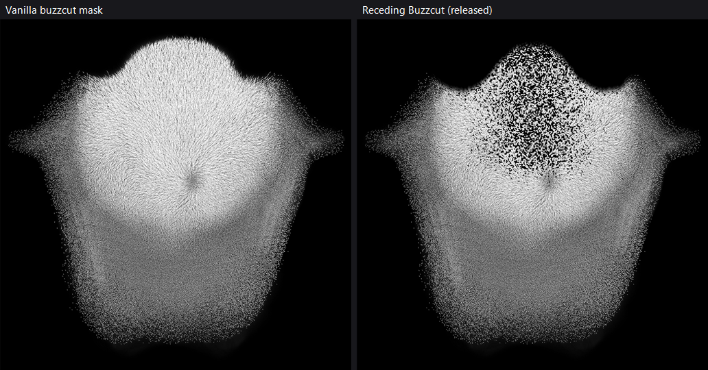

# Receding Buzzcut

New hairstyle for male V: a short buzzcut with a soft, rounded receding hairline at the temples and a top that is
slightly thinner than the sides.

- **Nexus Mods:** https://www.nexusmods.com/cyberpunk2077/mods/38003
- **Requires:** ArchiveXL (+ RED4ext)
- **Tested on:** game 2.5, ArchiveXL 1.28.2

It shows up as **"Receding Buzzcut"** in the character creator's hairstyle list (and at the mirror). It supports
every hair colour and the facial-cyberware variant. Nothing in the base game is replaced: the vanilla buzzcut is
still there and NPCs are unaffected.

## How it works

The vanilla buzzcut is not a 3D haircut. It is a thin "cap" mesh hugging the scalp, textured with a **mask**
(`hh_999_ma__cap_mask.xbm`, 1024×1024, white = hair). The mod keeps that cap and only redraws the mask.

### 1. The hairline mask (`scripts/hairline_mask.ps1`, `assets/cap_mask_receding.png`)

The vanilla mask is edited procedurally:

- **Hairline:** a curve across the forehead. It sits at `CenterLine` in the middle and drops back to `TempleLine` at
  `TempleX` on each side. `Roundness = 1` uses a smootherstep curve, which has no corners, so the hairline is rounded
  instead of a pointy "Dracula" V. Past the recession the line comes forward again with a Gaussian falloff.
  Low-frequency noise keeps the line irregular, like real hair.
- **Density:** three factors multiply together:
  - a Gaussian band along the top (`TopDensity`, `TopWidth`, `TopEndY`);
  - a thinner band just behind the hairline (`FrontDensity`, `FrontBand`);
  - a small thinning at the crown whorl (`CrownThin`).
- **Thinning that survives distance:** hairs are removed in coarse clumps (`Grain`), not pixel by pixel. With fine
  pruning, the mipmaps plus the alpha cut-off made thin areas look bald in game.

Texture orientation for tweaking: the top of the image is the forehead, about 100 px ≈ 3 cm of scalp, the top of
the head is around y = 310, the crown whorl is at (550, 470), and the side wings are the sideburns.



### 2. A new hairstyle instead of a replacer (`scripts/build_ccxl.ps1`)

The mod copies everything the vanilla buzzcut uses into its own `receding_buzzcut\` depot folder and points the
copies at the new mask:

| File | Source |
|---|---|
| `textures\cap_mask_receding.xbm` | the edited mask |
| `materials\*.mi` (71) | one material per hair colour, copied from the vanilla buzzcut |
| `meshes\buzz_cap_receding.mesh`, `..._cyberware_01.mesh` | vanilla cap meshes, re-pointed at the new materials/mask |
| `appearances\receding_buzzcut.app`, `..._cyberware_01.app` | vanilla `hh_013_pma__hairs_999*.app`, re-pointed at the new meshes |
| `materials\cap_base_receding*.mi` | ArchiveXL's buzzcut tint base material, with the new mask |
| `receding_buzzcut_male.inkcharcustomization` | the new character creator option |

The `.inkcharcustomization` is derived from the vanilla `male_cco.inkcharcustomization`. ArchiveXL merges it into
the game's own customization data. It contains:

- two **hair colour options** (`receding_buzzcut`, `receding_buzzcut_cw`), copied from `hair_color14` /
  `hair_color_cyberware_14` with unique indices (30001/30002);
- one new entry in each **hairstyle switcher** (`hairstyle`, `hairstyle_cyberware`). First person reuses the vanilla
  `hair_color_fpp_14`, because the hairline is not visible in FPP;
- the **option groups** `hairs` and `character_customization`. Without `hairs`, the hairstyle shows up but the
  colour picker has no effect.

`receding_buzzcut.archive.xl` registers the files with ArchiveXL:

- `customizations: male:` adds the character creator option;
- `resource: scope:` adds the `.app` and meshes to ArchiveXL's player hair scopes;
- `resource: fix:` gives the meshes the same colour-name mapping as the vanilla buzzcut. The mapping is copied at
  build time from ArchiveXL's `PlayerCustomizationHairFix.xl`, together with a `CapBaseMaterial` that uses the new
  mask. This is what makes the hairstyle **tintable**.

## Building

Requirements are listed in the [top-level README](../README.md). Then:

```powershell
cd receding-buzzcut
.\build.ps1 -Zip                       # dist\receding_buzzcut.archive, .archive.xl, Receding_Buzzcut-<version>.zip
.\build.ps1 -Install                   # also copies the two files into <game>\archive\pc\mod
.\build.ps1 -GamePath "D:\Games\Cyberpunk 2077" -WolvenKit "C:\tools\WolvenKit.CLI.exe"
```

The first run extracts the vanilla files it needs into `work\`, which takes a few minutes; later runs reuse them.

By default the build uses the released mask, [`assets/cap_mask_receding.png`](assets/cap_mask_receding.png), so the
79 files packed inside are byte-identical to the published `receding_buzzcut.archive`. The `.archive` itself gets a different hash on every pack, because WolvenKit writes some metadata such as timestamps.

### Tweaking the hairline

Passing any `scripts\hairline_mask.ps1` parameter to `build.ps1`, or `-Regenerate`, generates a new mask
procedurally instead of using the released one. It also writes `dist\hairline_preview.png`, which shows the
original mask and the new one with the hairline in red.

The defaults below are a starting point. The released mask was tuned by hand in several rounds, so the defaults do
not reproduce it exactly, but they come within about 1.6% of its pixels.

| Parameter | Default | Effect |
|---|---|---|
| `CenterLine` | 70 | Y of the hairline at the centre (vanilla ≈ 55). Higher = further back. |
| `TempleLine` | 200 | Y of the deepest point of each recession (vanilla ≈ 170). Higher = deeper. |
| `TempleX` | 210 | Distance of the recessions from the centre. |
| `Roundness` | 1.0 | 1 = rounded curve, 0 = straight-line V. |
| `VPower` | 1.15 | Shape of the V when `Roundness` < 1. |
| `SideFalloff` | 110 | How quickly the line comes forward past the recession. |
| `EdgeSoft` | 18 | Softness of the hairline edge. |
| `TopDensity` | 0.5 | Density on top relative to the sides (1 = same, 0 = bald). |
| `TopWidth` / `TopEndY` | 200 / 520 | Width and back limit of the thinned top. |
| `FrontDensity` / `FrontBand` | 0.85 / 70 | Thinning right behind the hairline. |
| `CrownThin` | 0.10 | Extra thinning at the crown. |
| `Grain` | 3 | Clump size of the thinning; larger survives distance better. |
| `Seed` | 1977 | Noise seed. |

Example: `.\build.ps1 -Install -TempleLine 240 -TopDensity 0.6`. Close the game first, because a running game locks
the `.archive`.

## Releasing

1. Update `Version` in `release/README.txt` and pass the same value with `-Version`.
2. Run `.\build.ps1 -Zip` and upload `dist\Receding_Buzzcut-<version>.zip` to Nexus.

The ZIP contains `archive/pc/mod/receding_buzzcut.archive`, `archive/pc/mod/receding_buzzcut.archive.xl` and
`README.txt`. It is written with `/` paths so that Vortex, MO2 and Linux/Steam Deck unpack it correctly; Windows
PowerShell's `Compress-Archive` writes `\` and should not be used.

## Notes and gotchas

- The `.inkcharcustomization` extension is the real name; there are no `.inkcc` files.
- `WolvenKit import -k` exits with code 3 and "No buffers found" when only textures are rebuilt. This is harmless.
- WolvenKit prints "Long path support is disabled" on stderr. It is harmless, but don't combine
  `$ErrorActionPreference = 'Stop'` with `2>$null` on WolvenKit calls, because the script will abort.
- Head-shape mods that change the scalp (for example narrowing the skull) make this cap clip, because the cap mesh
  has no morph targets.
